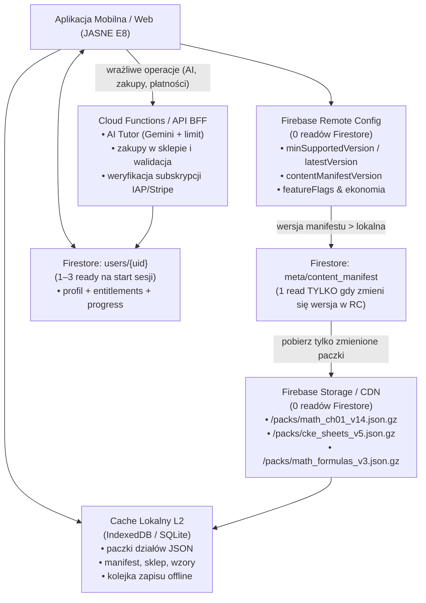

# JASNE E8 — Specyfikacja Architektoniczna Systemu Zadań, Firebase, Kont, Cache i UX (v1.0 Draft)

**Data:** 2026-11-19  
**Zakres:** Aplikacja mobilna (mobile-first) JASNE E8 — Faza 1: Matematyka (z architekturą gotową na Polski i Angielski)  
**Status:** Wersja robocza do akceptacji i domknięcia pytań decyzyjnych przed wdrożeniem (bez generowania samej treści zadań na tym etapie).

---

## 0. Stan infrastruktury (wdrożone 2026-11-19 — konto `mjankowski515@gmail.com`, Blaze)

| Element | Wartość | Status |
| :--- | :--- | :--- |
| Projekt Firebase | `jasne-e8-app` (numer `934617311874`, konto `mjankowski515@gmail.com`, plan Blaze — aktywne konto rozliczeniowe `01E979-286753-6687DC`) | ✅ aktywny (poprzedni `jasne-e8-prod` usunięty) |
| Firestore | standardowa baza `(default)`, region `europe-central2` (Warszawa), edycja Native | ✅ działa (`meta/content_manifest`, `config/live_ops`, `config/shop_catalog`, `admin_tasks`) |
| Reguły Firestore | `meta/**`, `config/**`, `content/**` — odczyt publiczny, zapis tylko serwer; `admin_tasks/**`, `server_config/**` — tylko serwer; `users/{uid}` — właściciel ze ścisłą walidacją pól; `private/**` i `ledger/**` — właściciel tylko odczyt, zapis tylko serwer | ✅ wdrożone i zweryfikowane testami live 6/6 (`firebase deploy --only firestore:rules,storage`) |
| Firebase Authentication | Email/Hasło + Anonymous Auth włączone; domeny autoryzowane (`jasne-e8-app-new.vercel.app`, `jasne-e8-admin.vercel.app`, `localhost`); konto admina `mjankowski515@gmail.com` z `customClaims.role = "admin"` | ✅ aktywny (Google Sign-In wymaga 1 kliknięcia OAuth w konsoli Firebase) |
| Firebase Storage | domyślny bucket `jasne-e8-app.firebasestorage.app` (`europe-central2`) + reguły `storage.rules` (`/packs/**` public read, `/users/{uid}/solutions/**` owner max 5 MB image, `/admin_uploads/**` tylko Admin SDK) | ✅ aktywny |
| Firebase Remote Config | szablon v1 (`contentManifestVersion`, `app_update_policy`, `feature_flags`, `economy_config`) | ✅ opublikowany i edytowalny z panelu admina |
| Aplikacja web (Vercel) | `jasne-e8-app-new` → https://jasne-e8-app-new.vercel.app | ✅ podpięta do `jasne-e8-app` |
| Panel admina (Vercel) | `jasne-e8-admin` → https://jasne-e8-admin.vercel.app (logowanie Firebase Auth + pełne API `/api/admin/*` dla CMS, paczek, Remote Config, LiveOps/Sklepu i uprawnień) | ✅ podpięty do `jasne-e8-app` |
| Konto serwisowe | `jasne-admin@jasne-e8-app.iam.gserviceaccount.com` (role: `datastore.user`, `firebase.sdkAdminServiceAgent`, `storage.objectAdmin`, `firebaserules.admin`, `firebase.admin`) | ✅ klucz wyłącznie w `.secrets/` (poza repo) i Vercel Env |

---

## 1. Analiza Oficjalnych Arkuszy CKE E8 (Matematyka) i Taksonomia Typów Zadań

Na podstawie analizy oficjalnych arkuszy Centralnej Komisji Egzaminacyjnej z matematyki dla egzaminu ósmoklasisty (**Maj 2024**: 19 zadań, 100 min, 30 pkt; **Maj 2025**: 21 zadań, 125 min, 30 pkt):
- **Część zamknięta:** 15 zadań po 1 pkt (15 pkt łącznie — ok. 50% wyniku).
- **Część otwarta:** 4–6 zadań po 2–3 pkt (15 pkt łącznie — wymagany pełny tok rozumowania; sam wynik daje 0 pkt; błąd rachunkowy przy poprawnej metodzie obniża punktację zazwyczaj o 1 pkt).
- **Wersje A i B arkusza CKE:** Różnią się wyłącznie kolejnością dystraktorów / wariantów. W JASNE E8 **nie duplikujemy wersji A/B** — przechowujemy kanoniczną treść zadania oraz flagę `shuffleOptions: boolean`, dzięki czemu aplikacja tasuje odpowiedzi dynamicznie.

### 1.1. Pełny katalog typów zadań w silniku JASNE E8

Dotychczasowe 4 typy (`abcd`, `true_false`, `numeric`, `open`) nie pokrywają wszystkich autentycznych formatów CKE. Docelowy silnik obsługuje **7 typów zadań**:

| Typ (`kind`) | Źródło / Zastosowanie | Punktacja CKE | Mechanika UI & Ocenianie |
| :--- | :--- | :--- | :--- |
| `single_choice` | CKE (najczęstszy) + Lekcje | 0–1 pkt | 4 kafelki (A–D), opcjonalne tasowanie opcji (`shuffleOptions: true`). |
| `true_false_multi` | CKE (np. Maj 2024 Zad. 1, Maj 2025 Zad. 7, 11, 12) | 0–1 pkt | 2 (lub 3) stwierdzenia do jednej sytuacji/wykresu. Każde oceniane P/F; 1 pkt egzaminacyjny wyłącznie za komplet poprawnych odpowiedzi (w lekcji feedback pokazuje ocenę każdego wiersza). |
| `dual_choice` | CKE (np. Maj 2024 Zad. 15, Maj 2025 Zad. 1, 4) | 0–1 pkt | Dokończenie 2 luk lub 2 podpunktów (np. A/B oraz C/D). 1 pkt za trafienie obu części. |
| `choice_with_reason` | CKE klasyk (wybierz A/B, ponieważ 1/2/3) | 0–1 pkt | Krok 1: decyzja (Tak/Nie lub A/B). Krok 2: uzasadnienie (1, 2 lub 3). 1 pkt wyłącznie za poprawną parę `(decision, reason)`. |
| `numeric_input` | Autorskie JASNE (trening pamięci mięśniowej) | 0–1 pkt | Brak gotowych opcji — uczeń wpisuje wynik przez `SmartMathKeyboard` (normalizacja ułamków, przecinków `10,0 = 10`, jednostek). |
| `open_calculation` | CKE (Zad. 16–21) + Lekcje | 0–2 lub 0–3 pkt | Obszar pracy: pismo odręczne / zdjęcie / klawiatura. Ocenianie według wieloetapowego klucza CKE (`scoringRubric`) — punkty częściowe (0/1/2/3). |
| `open_proof` | CKE („Wykaż / Uzasadnij”) | 0–2 pkt | Brak jednego wyniku liczbowego; oceniana poprawność logiczna argumentacji według kryteriów CKE (AI Tutor / samoocena z listą kontrolną). |

---

## 2. Model Bazy Zadań, Oznaczanie Źródła i Taksonomia

Każde zadanie jest niezależnym bytem w bazie zadań (`TaskRecord`), dzięki czemu to samo zadanie może działać w **Lekcji**, **Mini-Arkuszu**, **Pełnym Arkuszu CKE** oraz **Bazie Zadań**.

### 2.1. Oznaczanie pochodzenia zadania (`origin`)

Użytkownik i system zawsze widzą dokładne źródło zadania:
1. **`cke_official`** — autentyczne zadanie z oficjalnego arkusza CKE:
   - Pola: `year` (np. `2025`), `session` (`'maj' | 'czerwiec' | 'probny_grudzien' | 'pokazowy' | 'informator'`), `taskNumber` (np. `15`), `sheetId` (np. `'cke_e8_math_2025_maj'`).
   - Plakietka UI (niebieska/błękitna): np. **`CKE Maj 2025 • Zad. 15`**.
2. **`jasne_cke_variant`** — zadanie autorskie JASNE zbudowane jako izomorficzny wariant prawdziwego zadania CKE (inne liczby/kontekst, ta sama umiejętność i pułapka):
   - Pola: `inspiredByTaskId` (opcjonalne ID oryginału CKE), `authorVersion`.
   - Plakietka UI (bursztynowa/szmaragdowa): **`Wariant CKE • JASNE`**.
3. **`jasne_original`** — zadanie autorskie JASNE (np. rozgrzewka, trening konkretnego kroku, `numeric_input`):
   - Plakietka UI (neutralna/szmaragdowa): **`Zadanie JASNE`**.

### 2.2. Schemat danych zadania (`TaskRecord`)

```ts
export type TaskOriginKind = 'cke_official' | 'jasne_cke_variant' | 'jasne_original';

export type MathTaskKind =
  | 'single_choice'
  | 'true_false_multi'
  | 'dual_choice'
  | 'choice_with_reason'
  | 'numeric_input'
  | 'open_calculation'
  | 'open_proof';

export interface StaticHint {
  level: 1 | 2 | 3;
  title: string;           // np. "Wzór / Punkt startowy"
  body: string;            // Markdown + KaTeX, NIGDY nie zawiera gotowego wyniku
}

export interface TaskVisualAsset {
  kind: 'svg_inline' | 'storage_image' | 'chart_spec' | 'table';
  ref: string;             // klucz SVG, relatywny path w Storage lub JSON tabeli
  alt: string;             // dostępność (WCAG)
  aspectRatio?: number;
}

export interface TaskRecord {
  id: string;              // np. "cke_2025_maj_z15" lub "jsn_m_ch01_l01_004"
  subjectId: 'math' | 'polish' | 'english';
  kind: MathTaskKind;

  // Pochodzenie
  origin: {
    kind: TaskOriginKind;
    sheetId?: string;      // np. "cke_e8_math_2025_maj"
    year?: number;
    session?: 'maj' | 'czerwiec' | 'probny_grudzien' | 'pokazowy' | 'informator';
    taskNumber?: number;
    inspiredByTaskId?: string;
  };

  // Taksonomia (kluczowa dla lekcji, mini-arkuszy i filtrów)
  taxonomy: {
    primaryChapterId: string;       // np. "math_ch01" (1 z 7 działów E8)
    secondaryChapterIds?: string[]; // zadania przekrojowe (np. procenty + diagram)
    lessonIds: string[];            // lekcje, do których puli należy zadanie
    skillTags: string[];            // np. ["potegi_iloczyn", "pierwiastek_szescienny"]
    ckeRequirementCodes?: string[]; // kody podstawy programowej E8 (np. "I.3", "VIII.2")
  };

  // Metadane dydaktyczne i losowania
  difficulty: 1 | 2 | 3;            // 1 = baza/rozgrzewka, 2 = standard E8, 3 = trudne E8
  maxPoints: 1 | 2 | 3;
  estimatedSec: number;             // do pilnowania czasu lekcji i mini-arkuszy
  examEligible: boolean;            // czy może wpadać do losowanych mini-arkuszy
  lessonEligible: boolean;          // czy może wpadać do lekcji w ścieżce
  shuffleOptions?: boolean;         // domyślnie true dla single_choice

  // Treść i grafika
  prompt: string;                   // Markdown + KaTeX
  visual?: TaskVisualAsset;

  // Struktura odpowiedzi (polimorficzna zależnie od `kind`)
  payload: unknown;                 // specyficzny typ dla każdego z 7 `MathTaskKind`

  // Wyjaśnienie i wskazówki
  staticHints: StaticHint[];        // elastycznie 1–3 wskazówki (bez wymuszania 3 w prostych!)
  allowAiTutorHint: boolean;        // czy pokazywać przycisk "Zapytaj AI Tutora" po wyczerpaniu statycznych
  explanation: {
    steps: string[];                // krótkie kroki rozwiązania (mobile one-pager)
    finalAnswerDisplay: string;     // np. "Odpowiedź B (9)"
    ckeTrapNote?: string;           // "Na czym polega pułapka CKE"
  };

  // Cykl życia
  status: 'active' | 'archived';
  version: number;
}
```

### 2.3. System wskazówek (Hints): Ekonomiczny model Static-First + AI-On-Demand

1. **Zasada braku sztucznego rozdmuchiwania:** Pole `staticHints` ma długość **od 1 do 3** (nie wymuszamy 3 wskazówek dla prostego zadania rachunkowego):
   - Zadanie `difficulty: 1` (proste, 1 pkt): **1 wskazówka statyczna** (np. reguła / na co spojrzeć).
   - Zadanie `difficulty: 2` (standard E8, 1 pkt): **1–2 wskazówki statyczne** (reguła + pierwszy krok bez podania wyniku).
   - Zadanie `difficulty: 3` lub otwarte (`2–3 pkt`): **2–3 wskazówki statyczne** (strategia -> równanie/przekształcenie -> kontrola jednostek/warunku).
2. **Koszt 0 zł dla wskazówek bazowych:** Wszystkie `staticHints` pobierają się razem z paczką działu (lokalny cache) — zero wywołań LLM, natychmiastowe otwarcie (0 ms opóźnienia).
3. **Poziom AI Tutora (opcjonalny, limitowany kontem):**
   - Dostępny w zadaniach otwartych (analiza zdjęcia / pisma odręcznego / własnych obliczeń) oraz jako przycisk „Nadal nie rozumiem — zapytaj AI Tutora” po wyczerpaniu wskazówek statycznych.
   - Rozliczany z salda sprawdzeń/zapytań AI konta (patrz sekcja 6).

---

## 3. Projekt Lekcji, Losowanie bez Powtórek i Tryby Bazy Zadań

### 3.1. Jak powinna wyglądać lekcja w ramach działu (Blueprint Lekcji)

Każdy z 7 działów Matematyki E8 dzieli się na 3–5 lekcji atomowych. Lekcja nie ma „przyspawanych na sztywno” 5 zadań — posiada:
1. **Teorię Bento (4 karty):** Esencja → Wzory/Reguły → Przykład krok po kroku → Pułapka E8 (stała treść edukacyjna, aktualizowalna z Firebase).
2. **Blueprint zestawu zadań (5 slotów na sesję, czas 5–7 min):**

| Slot | Rola dydaktyczna | Dopuszczone typy | Trudność | Preferowane źródło |
| :--- | :--- | :--- | :--- | :--- |
| **1** | Rozgrzewka i utrwalenie pojęcia | `single_choice`, `true_false_multi` | `1` | `jasne_original` / `jasne_cke_variant` |
| **2** | Format typowy dla CKE (uważność) | `dual_choice`, `choice_with_reason`, `true_false_multi` | `2` | `cke_official` / `jasne_cke_variant` |
| **3** | Autentyczne zadanie egzaminacyjne | dowolny zamknięty CKE | `2` | **`cke_official`** (priorytet) |
| **4** | Sprawność bez zgadywania | `numeric_input` lub `single_choice` | `2–3` | `jasne_cke_variant` / `jasne_original` |
| **5** | Zadanie otwarte (pełny zapis) | `open_calculation` lub `open_proof` | `2–3` | `cke_official` lub `jasne_cke_variant` |

Docelowa pula w bazie na jedną lekcję to **15–25 zadań** (miks dostępnych oryginałów CKE + wariantów JASNE), co pozwala przejść tę samą lekcję 3–4 razy bez powtórki zadań.

### 3.2. Algorytm doboru zadań bez powtórek (Klient Offline-First)

Dla każdego slotu Blueprintu silnik filtruje pulę `lessonIds.includes(lessonId)` pasującą do kryteriów slotu i sortuje kandydatów według priorytetu:
1. **Priorytet 1 — Niewidziane (`unseen`):** zadania nieobecne w historii użytkownika (`taskHistory`).
2. **Priorytet 2 — Wymagające utrwalenia (`mistake` / `partial`):** zadania, w których uczeń popełnił błąd dawniej niż w ostatniej sesji (element powtórek rozłożonych w czasie).
3. **Priorytet 3 — Opanowane najdawniej (`mastered`):** posortowane rosnąco po `lastSeenAt`, żeby uniknąć powtórzenia zadań z przed chwilą.

Jeśli w którymś slocie brakuje dokładnego typu (np. w danym mikrodziale CKE nie było zadania `choice_with_reason`), Blueprint definiuje **fallback typów** (np. `choice_with_reason -> dual_choice -> single_choice`), więc sesja nigdy nie zostanie pusta ani nie rzuci błędu.

### 3.3. Cztery tryby pracy z bazą zadań

1. **Ścieżka Nauki (Lekcje):** Teoria Bento + 5 losowanych zadań wg Blueprintu. Po ukończeniu lekcji dostępne: *Powtórz teorię*, *Nowy zestaw zadań* (losuje świeże!), *Powtórz błędy*.
2. **Pełne Arkusze CKE (Archiwum Rocznikowe):** Zdefiniowane dokumentem `exam_sheets` (np. `cke_e8_math_2025_maj` — dokładna kolejność 21 zadań, prawdziwy czas 125 min lub tryb bez zegara, przeliczenie na % i punkty 0–30).
3. **Mini-Arkusze (Konfigurator):**
   - Zakres: **Przekrojowy E8** (proporcjonalne losowanie ze wszystkich 7 działów + mix zamknięte/otwarte jak w CKE) ALBO **Wybrane działy** (1 lub kilka działów).
   - Filtr źródła: `Wszystkie` / `Tylko oryginalne CKE` / `Tylko zadania JASNE`.
   - Rozmiar: np. Szybki (5 zadań / 15 min) lub Standard (10 zadań / 35 min).
4. **Baza Zadań (Katalog do samodzielnego przerabiania):**
   - Lista i szybki start serii z filtrami: **Źródło** (`CKE` / `Wariant CKE` / `Autorskie`), **Dział**, **Typ zadania**, **Rocznik CKE**, **Status ucznia** (`Nierozwiązane` / `Z błędem` / `Opanowane` / `Zapisane`).

---

## 4. Architektura Firebase: Minimalizacja Odczytów, Cache-First i Konfiguracja Zdalna

### 4.1. Jak działa rozliczanie Firebase i skąd biorą się koszty

- **Cloud Firestore:** płatność naliczana jest za **liczbę odczytów/zapisów dokumentów**, a nie za ich rozmiar (maks. 1 MiB na dokument). Darmowy limit (Spark / Blaze free tier): **50 000 odczytów i 20 000 zapisów dziennie**.
  - *Antywzorzec:* trzymanie każdego zadania w osobnym dokumencie (`tasks/{taskId}`) — pobranie 400 zadań przez 100 uczniów jednego dnia to 40 000 odczytów (prawie cały dzienny limit!).
  - *Wzorzec JASNE:* **Pakowanie treści w paczki (Content Packs) + Manifest wersji + 3-warstwowy cache**.
- **Firebase Remote Config:** **darmowy** (nielimitowane pobrania przy zachowaniu standardowego interwału odświeżania, np. 1–12h). Idealny na wersjonowanie aplikacji, flagi funkcji, ceny i numer wersji manifestu treści!
- **Firebase Storage (+ Cloud CDN):** transfer statycznych paczek JSON (skompresowanych gzipem) jest wielokrotnie tańszy niż odczyty dokumentów Firestore, a paczka 1 działu (150 zadań + teoria) waży zaledwie **~60–120 KB**.

### 4.2. Hybrydowa architektura danych (Zero zbędnych odczytów)



### 4.3. Szacunek odczytów Firestore na aktywnego użytkownika dziennie

| Zdarzenie | Bez optymalizacji (naiwnie) | Architektura JASNE (Pack + Manifest + RC) |
| :--- | :--- | :--- |
| Uruchomienie apki (brak zmian treści) | 200–500 readów | **0 readów treści** (Remote Config potwierdza ten sam `manifestVersion`) + **2–3 ready** danych użytkownika |
| Pobranie nowego działu (150 zadań) | 150 readów | **0 readów Firestore** (1 pobranie pliku JSON z Storage/CDN) lub **1 read** jeśli paczka w Firestore |
| Rozwiązanie 5 zadań w lekcji | 5–15 zapisów | **1 zbiorczy zapis** po ukończeniu lekcji (w trakcie: zapis wyłącznie lokalnie!) |
| Otwarcie Sklepu / Wzorów / Wyzwań | 30–50 readów | **0 readów** (z lokalnego cache po pierwszym pobraniu configu) |
| **RAZEM / dzień / aktywny uczeń** | **~300–600 operacji** | **~3–6 odczytów i 2–4 zapisy dziennie** (~100× taniej!) |

### 4.4. Co wrzucić do Firebase, żeby zarządzać aplikacją bez wydawania aktualizacji (Server-Driven)

Wszystkie poniższe elementy mogą być zmieniane z jednego centralnego systemu (Remote Config + panel/skrypt publikujący paczki) **bez rekompilacji i bez czekania na review App Store / Google Play**:

| Obszar | Miejsce w Firebase | Co można zmieniać zdalnie? |
| :--- | :--- | :--- |
| **Aktualizacje i tryb serwisowy** | Remote Config | `min_supported_version`, `latest_version`, `force_update`, `changelog_pl`, linki do sklepów, `maintenance_mode` + komunikat Lumi. |
| **Flagi funkcji (Feature Flags)** | Remote Config | Włączanie Polskiego / Angielskiego, AI foto-oceny, mikropłatności, nowych trybów egzaminu, testów A/B. |
| **Balans ekonomii i limitów** | Remote Config | Cena Tarczy Serii (450), cena Serca (80), maks. serc (5), czas regeneracji serca, progi Combo, darmowy dzienny limit AI, limity AI dla pakietów Pro, nagrody XP/monet. |
| **Treść edukacyjna (Kurikulum)** | Storage JSON + `meta/content_manifest` | Nowe działy, lekcje Bento, poprawki literówek, dodawanie kolejnych roczników CKE (np. Maj 2026) i wariantów JASNE, Karta Wzorów E8. |
| **Sklep Lumi i Kosmetyki** | Firestore `config/shop_catalog` (cache'owany) | Ceny, promocje, ukrycie/pokazanie przedmiotów, opisy, kolejność, nowe tytuły i palety kolorów (nowe wektory akcesoriów — gdy ładowane jako zewnętrzne SVG lub z biblioteki assetów). |
| **Eventy, Banery, Odliczanie E8** | Firestore `config/live_ops` (cache'owany) | Data najbliższego egzaminu E8 (odliczanie na Starcie), baner ogłoszeniowy, weekend `2x XP`, tymczasowe pule wyzwań dziennych. |
| **Prompty i modele AI Tutora** | Backend (Cloud Functions / Firestore `server_config/ai`) | Wersja modelu Gemini, system prompt, kryteria punktowania, limity tokenów — zero zmian w aplikacji klienckiej. |

### 4.5. System Powiadamiania o Aktualizacji Aplikacji (Soft & Force Update)

Zrealizowany przez **Firebase Remote Config** (parametry per platforma `ios`, `android`, `web_pwa`):

```json
{
  "app_update_policy": {
    "ios": {
      "minSupportedVersion": "1.0.0",
      "latestVersion": "1.2.0",
      "storeUrl": "https://apps.apple.com/app/id..."
    },
    "android": {
      "minSupportedVersion": "1.0.0",
      "latestVersion": "1.2.0",
      "storeUrl": "https://play.google.com/store/apps/details?id=..."
    },
    "web": {
      "minSupportedBuild": "2026.11.19.1",
      "latestBuild": "2026.11.25.1"
    },
    "titlePl": "Nowa wersja JASNE E8 jest gotowa!",
    "highlightsPl": [
      "Dodano pełny arkusz CKE Maj 2025",
      "Nowe animacje Lumi i szybsze sprawdzanie AI"
    ],
    "remindAfterHours": 24
  }
}
```

**Zachowanie aplikacji po porównaniu wersji (SemVer):**
1. **`currentVersion < minSupportedVersion` (Force Update):**
   - Pełnoekranowy, nieusuwalny modal z maskotką Lumi (`surprised` / `supportive`), listą zmian i jednym głównym przyciskiem **„Zaktualizuj teraz”** (przekierowanie do App Store / Google Play lub twardy reload Service Workera na Web/PWA).
2. **`minSupportedVersion <= currentVersion < latestVersion` (Soft Update):**
   - Estetyczny Bottom Sheet (lub karta na ekranie Start) z listą 2–3 nowości i dwoma przyciskami: **„Zaktualizuj”** oraz **„Później”** (wycisza przypomnienie na `remindAfterHours`, np. 24h, zapisane lokalnie; nie przerywa aktywnej lekcji ani egzaminu — pokazuje się tylko na ekranie Start!).
3. **Aktualizacja samych treści (OTA Content Update — bez sklepu):**
   - Gdy zmieni się tylko `contentManifestVersion`, aplikacja **nie wymaga aktualizacji ze sklepu** — pobiera w tle nowe paczki JSON i pokazuje subtelny toast: *„Zaktualizowano bazę zadań (+15 nowych zadań CKE)”*.

---

## 5. System Kont, Logowania, Danych Użytkownika i Uprawnień (Pakiety / AI / Monety)

### 5.1. Przepływ logowania i rejestracji (Zero-Friction + Bezpieczne zachowanie postępów)

1. **Wejście bez tarcia (Guest / Firebase Anonymous Auth):**
   - Przy pierwszym uruchomieniu po onboardingu z Lumi tworzony jest anonimowy `uid` w Firebase Auth (lub lokalny gość promowany do konta anonimowego w tle). Uczeń od razu się uczy — **zero ściany rejestracji**.
2. **Konwersja na pełne konto (Account Linking):**
   - Metody logowania: **Google**, **Apple Sign-In** (obowiązkowe na iOS, jeśli jest jakikolwiek social login!), **Email + Hasło / Magic Link**.
   - Używamy `linkWithCredential` — dotychczasowe postępy, seria, monety i kosmetyki Lumi przechodzą płynnie pod to samo `uid`.
   - **Naturalne momenty zachęty:** (a) po ukończeniu 1. lekcji (*„Zapisz swój postęp i Lumi w chmurze”*), (b) po osiągnięciu serii 3 dni, (c) przed zakupem pakietu / subskrypcji (wymagane, żeby zakup przypisać do konta).
   - **Obsługa kolizji (`auth/credential-already-in-use`):** Gdy uczeń loguje się na istniejące konto na nowym telefonie, aplikacja wyświetla jasny wybór: *„Wczytaj konto z chmury (X XP, seria Y dni)”* vs *„Anuluj”*.

### 5.2. Podział danych użytkownika w Firestore i model bezpieczeństwa

Kluczowa zasada: **klient nigdy nie może sam sobie dopisać monet, pakietu Pro ani kredytów AI.** Dlatego rozdzielamy profil edytowalny od uprawnień zarządzanych wyłącznie przez serwer:

```text
users/{uid}
├── (dokument główny — odczyt/zapis wybranych pól preferencji przez klienta)
│   ├── profile: { nickname, studyStage, activeSubject, dailyGoalMinutes, avatarLoadout }
│   ├── prefs: { theme, sfxEnabled, hapticsEnabled }
│   ├── gamificationPublic: { xp, rankId, streakDays, bestCombo, lastCompletedPlayerDay, totalTasksSolved }
│   ├── account: { isAnonymous, providers[], createdAt, lastActiveAt, appVersion, platform }
│   └── schemaVersion: 2
│
├── private/entitlements   [KLIENT: TYLKO ODCZYT | ZAPIS: WYŁĄCZNIE SERWER / CLOUD FUNCTIONS]
│   ├── plan: 'free' | 'pro_monthly' | 'pro_season' | 'pro_year'
│   ├── planStatus: 'active' | 'grace_period' | 'expired' | 'none'
│   ├── planExpiresAt: Timestamp | null
│   ├── storeProvider: 'apple_iap' | 'google_play' | 'stripe_blik' | 'promo' | null
│   ├── coins: number
│   ├── hearts: number
│   ├── heartRefillAnchorAt: Timestamp | null
│   ├── streakShields: number
│   ├── aiQuota: {
│   │     dailyFreeUsed: number,
│   │     dailyFreeDay: string,          // YYYY-MM-DD (Europe/Warsaw)
│   │     monthlyPlanRemaining: number,  // np. 150 dla Pro (ochrona przed abuse)
│   │     monthlyPlanResetAt: Timestamp | null,
│   │     purchasedPackCredits: number   // niewygasające kredyty z dokupionych paczek
│   │   }
│   ├── ownedItemIds: string[]           // odblokowane skórki, akcesoria, ramki, tytuły
│   └── unlockedEmotions: string[]       // (opcjonalnie) dodatkowe reakcje/emocje Lumi
│
├── progress/{subjectId}   [np. progress/math — 1 dokument na przedmiot!]
│   ├── completedLessonIds: string[]
│   ├── lessonStats: { [lessonId]: { completions, bestScore, lastAt } }
│   ├── taskHistory: { [taskId]: { s: 0|1|2, c: number, w: number, t: number } }
│   │   // kompaktowy zapis: status (0=błąd,1=część,2=ok), correctCount, wrongCount, lastSeenEpochSec
│   ├── mistakeBank: Array<{ taskId, correctStreak, lastMistakeAt }>
│   ├── savedTaskIds: string[]
│   └── updatedAt: Timestamp
│
├── exam_attempts/{attemptId}  [subkolekcja — wczytywana na żądanie w historii]
│   └── { sheetId, mode, scorePercent, pointsEarned, pointsMax, durationSec, completedAt, answersSummary }
│
└── ledger/{txId}          [KLIENT: TYLKO ODCZYT | ZAPIS: WYŁĄCZNIE SERWER]
    └── { type: 'lesson_reward' | 'shop_purchase' | 'ai_check' | 'iap_grant' | 'refund',
          deltaCoins, deltaAiCredits, refId, idempotencyKey, createdAt }
```

### 5.3. Bezpieczne rozliczanie sprawdzeń AI i nagród

- **Kolejność zużywania sprawdzeń AI (serwerowo w transakcji Firestore):**
  1. Najpierw darmowy dzienny limit (`dailyFreeUsed < config.freeDailyAiLimit`).
  2. Następnie pula miesięczna pakietu Pro (`monthlyPlanRemaining > 0`).
  3. Na końcu dokupione, niewygasające paczki sprawdzeń (`purchasedPackCredits > 0`).
- **Zasada uczciwego błędu:** Jeśli wywołanie modelu AI zwróci timeout lub błąd serwera, funkcja cofa zużycie kredytu w tej samej procedurze (`refund`) — uczeń nigdy nie traci sprawdzenia przez awarię sieci.
- **Ochrona przed nadużyciem (App Check + Rate Limit):** Wszystkie endpointy AI i ekonomii wymagają ważnego tokena **Firebase Auth** oraz **Firebase App Check** (DeviceCheck/App Attest na iOS, Play Integrity na Androidzie, reCAPTCHA Enterprise na Web).
- **Wiek ucznia (E8 = ok. 13–14 lat, RODO / COPPA):** Minimalizacja zbieranych danych osobowych (ksywka zamiast imienia i nazwiska, brak publicznego czatu, brak reklam profilowanych, łatwe usunięcie konta z poziomu Ustawień — wymóg Apple App Store!).

---

## 6. System Animacji Ładowania (Lumi Loading Choreography)

Wszystkie stany ładowania są budowane na GPU (`transform`, `opacity`), 60 FPS, z pełnym poszanowaniem `prefers-reduced-motion` i bez skoków układu (CLS = 0).

| Scenariusz | Komponent / Zachowanie | Animacja Lumi & Mikro-copy | Warunek wyświetlenia |
| :--- | :--- | :--- | :--- |
| **1. Cold Start (Uruchomienie)** | Pełnoekranowy Splash z logo JASNE i Lumi na środku + cienki pasek postępu | Lumi w płynnym cyklu „rozgrzewki” (miękki podskok + oddychający płomyk). Rotujące krótkie teksty co 1,5 s: *„Lumi szykuje wzory…”*, *„Sprawdzam Twoją serię…”*. | Pokazywany **tylko** przy zimnym starcie. Przy trafieniu w lokalny cache znika w `< 150 ms` bez migotania. |
| **2. Pobieranie paczki działu / arkusza** | **Layout Skeleton** 1:1 odpowiadający karcie Bento / liście zadań (subtelny shimmer bez neonów) + kompaktowa pigułka z mini-Lumi | Lumi (`mood="loading"`) delikatnie kołysząca się z 3 orbitującymi iskierkami + pasek % pobrania paczki (np. `Pobieram Dział 2 (85 KB)...`). | Wyłącznie gdy paczki nie ma jeszcze w IndexedDB/SQLite. Opóźnienie 150 ms przed pokazaniem, by uniknąć błysku na szybkim łączu. |
| **3. Sprawdzanie zadania przez AI Tutora** | Dedykowana karta analizy z miękkim skanerem przesuwającym się po podglądzie rozwiązania ucznia | Lumi (`mood="thinking"`) z pulsującą żarówką pomysłu i 3-etapowym wskaźnikiem postępu: (1) *Odczytuję obliczenia…* → (2) *Sprawdzam metodę wg klucza CKE…* → (3) *Przygotowuję wskazówkę…*. | Przy każdym wywołaniu backendu AI (typowo 1,5–4 s). |
| **4. Zapis postępu / zakup / zmiana skórki** | **Optimistic UI** — brak blokującego ekranu ładowania | Natychmiastowa animacja nagrody/wyposażenia + dyskretna ikonka synchronizacji chmury w rogu (z automatycznym retry w tle przy braku zasięgu). | Zawsze dla lekkich mutacji użytkownika. |

---

## 7. Audyt i Plan Delikatnego Ulepszenia Maskotki Lumi (`LumiMascot.tsx`)

Po analizie bieżącego kodu `src/components/mascot/LumiMascot.tsx` (587 linii) zidentyfikowano 5 konkretnych usprawnień, które znacząco podniosą jakość wizualną Lumi bez zmiany jej tożsamości:

1. **Objętość i światło 3D (zamiast płaskiej łezki):**
   - Zastąpienie prostego liniowego gradientu korpusu gradientem **radialnym** z miękkim rozjaśnieniem czołowym oraz dodanie delikatnego dolnego **rim-light** (odbitego światła przy dolnej krawędzi), dzięki czemu Lumi nabierze charakteru dopracowanej figurki 3D (Tactile Gaming).
2. **Wyraziste, żywe łapki i niezależny ruch czubka płomyka (*follow-through*):**
   - Obecne rączki to sztywne, oderwane elipsy. Proponowana zmiana: organiczne zaokrąglone „łapki-iskierki” z własną mikro-animacją (`motion.g`) zależną od nastroju (unoszone w `celebrate`, jedna przy brodzie w `thinking`, obejmujące serce w `supportive`).
   - Niezależne, lekko opóźnione kołysanie czubka płomyka (`Top Flame Crest`), które nadaje postaci naturalną sprężystość.
3. **Rozdzielenie mrugania od emocji `happy` + żywsze oczy:**
   - Obecnie mrugnięcie renderuje te same łuki `^ ^` co `happy`, przez co Lumi w stanie `idle` chwilowo wygląda jak śmiejąca się. Mruganie powinno płynnie spłaszczać źrenice (`scaleY` -> `0.12`) lub rysować miękką zamkniętą powiekę, a `happy`/`celebrate` zostawić dla łuków `^ ^`.
   - Miękkie rumieńce z radialnym zanikaniem zamiast ostrych owali.
4. **Drobne poprawki spójności kosmetyków:**
   - W `shopCatalog.ts` opis czapki mówi *„Czerwona czapka z daszkiem”*, podczas gdy w `LumiMascot.tsx` kolor to niebieski (`#2563EB`) — do uzgodnienia i ujednolicenia.
   - Ukrywanie lub dopasowanie górnego płomyka (`Top Flame Crest`), gdy założona jest czapka z daszkiem lub korona, żeby elementy na siebie nie nachodziły.
5. **Nowy nastrój `loading` (pod choreografię ładowania):**
   - Lumi z 3 krążącymi wokół niej drobnymi iskierkami i rytmicznym, lekkim podskokiem.

---

## 8. Osobna Aplikacja — Panel Dewelopera i Redakcji (`jasne-e8-admin`)

Aby zachować lekkość aplikacji ucznia (`jasne-e8-app-new`, mobile-first) i bezpieczeństwo bazy produkcyjnej, zarządzanie bazą odbywa się w **osobnej aplikacji webowej** wdrażanej na oddzielnym projekcie Vercel (np. `jasne-e8-admin.vercel.app`), podpiętej do tego samego projektu Firebase (przez Firebase Auth z rolą `admin`/`editor` + serwerowe API z Firebase Admin SDK).

*Uwaga do stanu zastanego:* dotychczasowe `DevCurriculumInspectorView` i `DevHubModal` w starszym forku `jasne-e8` (`https://jasne-e8.vercel.app`) to wyłącznie wbudowany inspektor/debugger read-only, a nie osobny CMS. Nowy `jasne-e8-admin` zastępuje go pełnym narzędziem operacyjnym:

| Moduł panelu | Funkcjonalność | Wpływ na aplikację ucznia |
| :--- | :--- | :--- |
| **1. Edytor Zadań & Lekcji (CMS)** | Tworzenie/edycja wszystkich 7 typów zadań CKE E8, podgląd na żywo w ramce `390px` (KaTeX + SVG), tagowanie działów/lekcji/źródła (`CKE` vs `JASNE`), edycja 1–3 wskazówek statycznych i teorii Bento. | Zapis jako `draft` — bez wpływu na uczniów do momentu publikacji. |
| **2. Importer CKE (PDF → Szkice AI)** | Wgrywanie oficjalnych arkuszy CKE (PDF), ekstrakcja zadań do stanu `draft` z obowiązkową ręczną recenzją i wyborem modelu AI. | Brak ryzyka wypuszczenia błędnych zadań z AI bezpośrednio na produkcję. |
| **3. Centrum Publikacji Paczek (Release)** | Walidacja schematu (KaTeX, poprawne klucze, brak duplikatów) + 1 kliknięcie **„Opublikuj paczkę”** → generuje JSON w Storage/CDN, podbija `meta/content_manifest` i `contentManifestVersion` w Remote Config. | Aplikacje uczniów pobierają tylko zmieniony dział w tle (0 readów Firestore przy braku zmian). |
| **4. Remote Config & Update Manager** | Zarządzanie `minSupportedVersion` (Force Update), `latestVersion` (Soft Update), changelogiem, trybem serwisowym, flagami funkcji (Polski/Angielski) i balansem ekonomii (ceny, limity AI/serc). | Natychmiastowa zmiana zachowania apki bez publikacji nowej wersji w App Store / Google Play. |
| **5. Sklep Lumi & LiveOps** | Edycja katalogu sklepu, cen, promocji, banerów na Starcie, daty egzaminu E8 i weekendów `2x XP`. | Odświeżenie z cache bez aktualizacji kodu. |
| **6. Konta, Uprawnienia & DevTools** | Wyszukiwanie konta po `uid`/emailu/ksywce, przyznawanie testowych monet / pakietu Pro / sprawdzeń AI, podgląd `ledger` (historia transakcji) i logów ocen AI Tutora. | Bezpieczne operacje wyłącznie przez Admin SDK z wpisem do audytu. |

---

## 9. Otwarte Decyzje Architektoniczne (Pytania do Użytkownika przed zamrożeniem v1.1)

Zanim przejdziemy do projektowania reguł Firestore, schematów walidacji i implementacji, potrzebujemy decyzji w 6 kluczowych punktach:

1. **Docelowa technologia aplikacji mobilnej:**
   - Czy `jasne-e8-app-new` (Next.js) ma pozostać jako **PWA + wrapper Capacitor** (jedna baza kodu Web + iOS + Android), czy planujemy osobny przepis na **React Native (Expo) / Flutter**, a obecny Next.js służy jako prototyp/web? *(To determinuje wybór SDK Firebase, lokalnego cache IndexedDB vs SQLite/MMKV oraz płatności Apple IAP / Google Play Billing vs Stripe/BLIK).*
2. **Instancja Firebase:**
   - Czy JASNE E8 korzysta z **osobnego projektu Firebase** (oddzielonego od maturalnego `jasne-7efe7`), czy z tej samej instancji w nowej przestrzeni nazw (np. `e8_...`)? *(Zalecenie: osobny projekt Firebase dla E8 — czysta izolacja kont, kosztów, Remote Config i reguł bezpieczeństwa).*
3. **Model monetyzacji i limity sprawdzeń AI:**
   - Jakie konkretne pakiety chcesz mieć w E8 na start? Np.:
     - **Free:** pełna teoria + lekcje + np. `X` darmowych sprawdzeń AI dziennie (np. 2–3) + 5 serc.
     - **Pass E8 Pro (subskrypcja / sezon do maja):** nielimitowane serca + np. `Y` sprawdzeń AI / miesiąc (soft-cap przeciw botom, np. 150–200) + wszystkie pełne arkusze CKE.
     - **Paczki jednorazowe (top-up):** np. +20 sprawdzeń AI, Tarcze Serii, pakiety kosmetyków?
4. **Dostępność pełnej Bazy Zadań CKE (Free vs Pro):**
   - Czy zbiór wszystkich oryginalnych zadań CKE i pełne arkusze rocznikowe mają być w pełni darmowe (a płatne jest AI + brak limitu serc + kosmetyki), czy np. część arkuszy / trybów jest w Pro?
5. **Zarządzanie treścią (CMS / Publikacja paczek zadań):**
   - Czy na tym etapie wolisz publikować paczki zadań do Firebase **skryptem z repo (JSON -> CLI seed do Storage/Firestore)** (jak w maturalnym JASNE), czy od razu planujemy prosty **wewnętrzny panel admina** w przeglądarce?
6. **Ulepszenie maskotki Lumi i animacji ładowania:**
   - Czy chcesz, żebym **już teraz** (równolegle z domknięciem tej specyfikacji) wdrożył delikatne ulepszenie `LumiMascot.tsx` + komponenty `LumiLoader` w `jasne-e8-app-new` i wypchnął podgląd na Vercel, czy najpierw domykamy wszystkie punkty specyfikacji?
